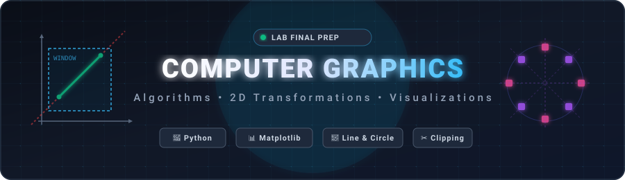
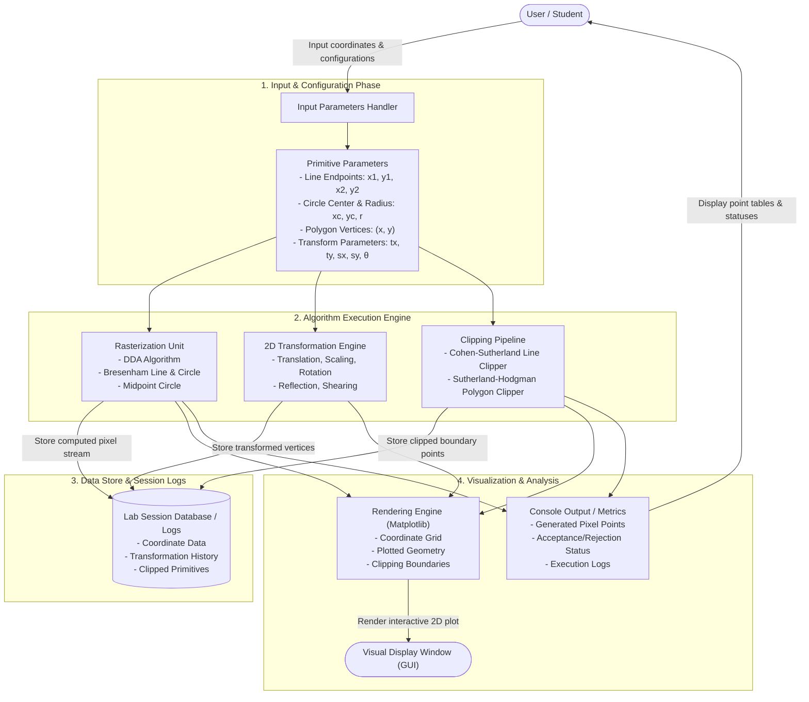
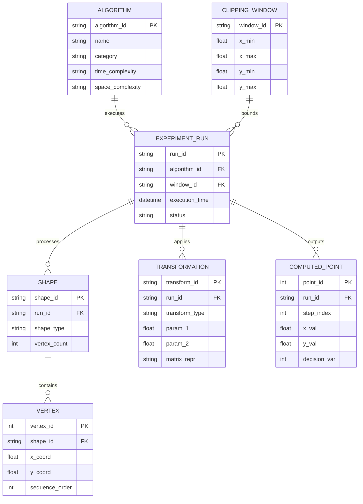

<p align="center">
  
</p>

<p align="center">
  <a href="https://github.com/AbdullahNoman-01/computer-graphics/archive/refs/heads/main.zip">
    
  </a>
  <br/>
  <sub>👉 <a href="https://github.com/AbdullahNoman-01/computer-graphics/archive/refs/heads/main.zip"><b>Click here to Direct Download the Complete Folder (ZIP)</b></a></sub>
</p>

<p align="center">
  
  
</p>

---

## 📌 Overview

This repository contains clean, ready-to-run Python implementations of essential **Computer Graphics (CG)** algorithms and 2D transformations prepared for university laboratory examinations and academic evaluation. Every implementation is paired with visual plotting and coordinate rendering using `matplotlib`.

---

## 📂 Included Algorithms & Scripts

| Category | File | Description |
| :--- | :--- | :--- |
| **Line Drawing** | [`ddl_line_drawing_algo.py`](./ddl_line_drawing_algo.py) | Digital Differential Analyzer (DDA) Line Drawing Algorithm |
| | [`bresenham's_line_drawing_algo.py`](./bresenham's_line_drawing_algo.py) | Bresenham's Line Drawing Algorithm using integer arithmetic |
| **Circle Drawing** | [`midpoint_cycle_drawing_algo.py`](./midpoint_cycle_drawing_algo.py) | Midpoint Circle Drawing Algorithm with 8-way symmetry |
| | [`bresenham's_cycle_drawing_algo.py`](./bresenham's_cycle_drawing_algo.py) | Bresenham's Circle Drawing Algorithm |
| **2D Transformations** | [`translation.py`](./translation.py) | 2D Translation (shifting coordinates by dx, dy) |
| | [`scaling.py`](./scaling.py) | 2D Scaling (resizing shapes with Sx, Sy) |
| | [`rotation.py`](./rotation.py) | 2D Rotation around the origin by angle $\theta$ |
| | [`reflection.py`](./reflection.py) | 2D Reflection across axes (X-axis, Y-axis, or origin) |
| | [`sharing.py`](./sharing.py) | 2D Shearing (distortion along X or Y axis) |
| **Clipping** | [`line_clipping.py`](./line_clipping.py) | Cohen-Sutherland Line Clipping Algorithm with outcodes |
| | [`polygon_clipping.py`](./polygon_clipping.py) | Sutherland-Hodgman Polygon Clipping Algorithm |

---

## 🔄 System Architecture & Data Flow Diagram (DFD)

The following diagram illustrates how user parameters enter the system, flow through specific algorithm processing units, generate discrete coordinate datasets, and render through `matplotlib`.



---

## 🗄️ Database Design (Graphics Lab Workbench Schema)

For academic presentation, record auditing, and automated experiment verification, the system data architecture is modeled as a relational schema representing shapes, algorithms, parameters, transformation history, and clipping boundaries.

### Entity-Relationship (ER) Diagram



### Relational Schema Specification

1. **`ALGORITHMS`**: Stores catalog of implemented computer graphics algorithms.
   - `algorithm_id` (VARCHAR(10), Primary Key)
   - `name` (VARCHAR(100), e.g., 'Bresenham Line Drawing')
   - `category` (VARCHAR(50), e.g., 'Rasterization', 'Transformation', 'Clipping')
   - `time_complexity` (VARCHAR(20), e.g., 'O(dx)', 'O(N)')
   - `space_complexity` (VARCHAR(20), e.g., 'O(1)')

2. **`EXPERIMENT_RUNS`**: Audit trail of every execution during lab sessions.
   - `run_id` (VARCHAR(36), Primary Key)
   - `algorithm_id` (VARCHAR(10), Foreign Key referencing `ALGORITHMS`)
   - `window_id` (VARCHAR(20), Foreign Key referencing `CLIPPING_WINDOWS`, Nullable)
   - `execution_timestamp` (TIMESTAMP, default CURRENT_TIMESTAMP)
   - `status` (VARCHAR(20), e.g., 'Success', 'Rejected', 'Clipped')

3. **`SHAPES` & `VERTICES`**: Defines geometric entities and ordered coordinates.
   - `SHAPES`: `shape_id` (PK), `run_id` (FK), `shape_type` ('Point', 'Line', 'Circle', 'Polygon')
   - `VERTICES`: `vertex_id` (PK), `shape_id` (FK), `x_coord` (FLOAT), `y_coord` (FLOAT), `sequence_order` (INT)

4. **`TRANSFORMATIONS`**: Logs mathematical operations applied to geometries.
   - `transform_id` (PK), `run_id` (FK), `transform_type` ('Translation', 'Scaling', 'Rotation', 'Reflection', 'Shearing'), `param_1`, `param_2`, `matrix_repr`

5. **`CLIPPING_WINDOWS`**: Defines boundary extents for line and polygon clipping.
   - `window_id` (PK), `x_min`, `x_max`, `y_min`, `y_max`

6. **`COMPUTED_POINTS`**: Stores rasterized raster points computed per step/decision parameter.
   - `point_id` (PK), `run_id` (FK), `step_index` (INT), `x_val` (FLOAT), `y_val` (FLOAT), `decision_var` (INT)

---

## 🚀 How to Run

### 1. Requirements
Make sure Python 3.x and `matplotlib` are installed:
```bash
pip install matplotlib
```

### 2. Execute any script
Run any algorithm directly from the terminal or IDE:
```bash
python line_clipping.py
```

---

<div align="center">
  <sub>Computer Graphics Lab Final Preparation • Made with Python & Matplotlib</sub>
</div>
