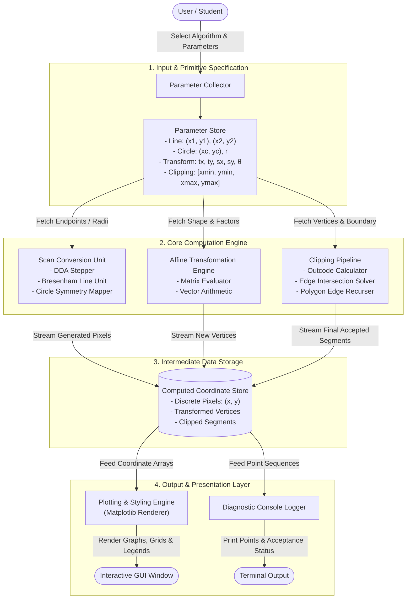
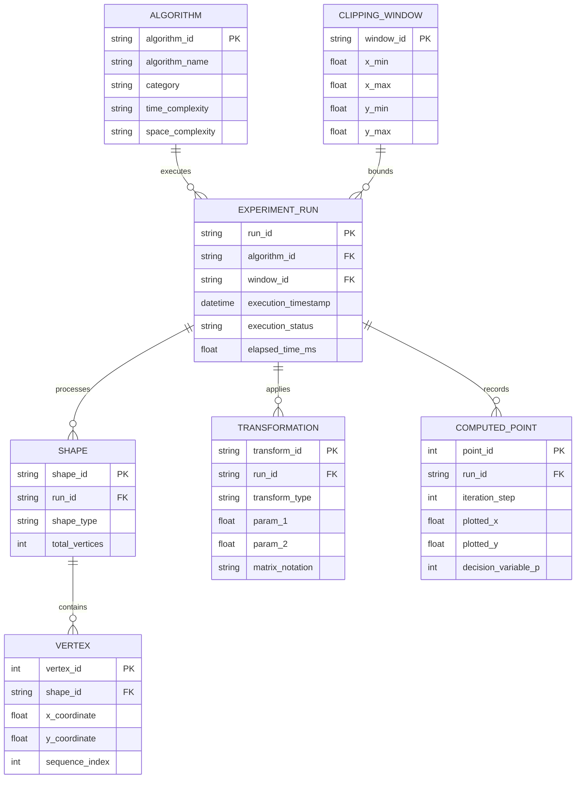
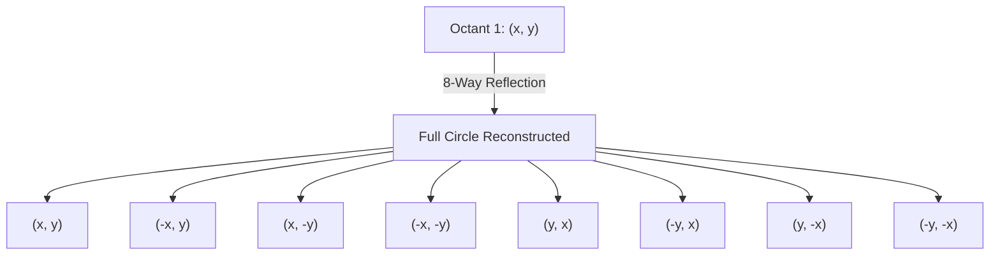

# 🎓 PROJECT REPORT: IMPLEMENTATION AND ANALYSIS OF FUNDAMENTAL COMPUTER GRAPHICS ALGORITHMS & 2D TRANSFORMATIONS

**Course Title:** Computer Graphics and Multimedia Laboratory  
**Course Code:** CSE 3xx / ICE 3xx  
**Academic Session:** 3rd Year 2nd Semester  
**Department:** Department of Computer Science & Engineering  
**Project Title:** Interactive Visualization and Algorithmic Analysis of 2D Computer Graphics Primitives, Transformations, and Clipping Pipelines  
**Author / Student Name:** [Your Name / Student ID]  
**Repository Link:** [https://github.com/AbdullahNoman-01/computer-graphics](https://github.com/AbdullahNoman-01/computer-graphics)  
**Date of Submission:** November 2026  

---

## 📑 TABLE OF CONTENTS

1. [Executive Summary / Abstract](#1-executive-summary--abstract)
2. [Introduction and Project Scope](#2-introduction-and-project-scope)
3. [System Architecture and Data Flow Diagram (DFD)](#3-system-architecture-and-data-flow-diagram-dfd)
4. [Database and Data Model Design](#4-database-and-data-model-design)
5. [In-Depth Algorithmic Breakdown](#5-in-depth-algorithmic-breakdown)
   - 5.1 [Line Generation Algorithms (DDA vs. Bresenham)](#51-line-generation-algorithms)
   - 5.2 [Circle Generation Algorithms (Midpoint vs. Bresenham)](#52-circle-generation-algorithms)
   - 5.3 [Two-Dimensional Geometric Transformations](#53-two-dimensional-geometric-transformations)
   - 5.4 [Clipping Algorithms (Cohen-Sutherland & Sutherland-Hodgman)](#54-clipping-algorithms)
6. [Complexity Analysis and Comparative Evaluation](#6-complexity-analysis-and-comparative-evaluation)
7. [Experimental Setup, Execution, and Verification](#7-experimental-setup-execution-and-verification)
8. [University Viva Voce / Presentation Q&A Guide](#8-university-viva-voce--presentation-qa-guide)
9. [Conclusion and Future Work](#9-conclusion-and-future-work)
10. [References](#10-references)

---

## 1. EXECUTIVE SUMMARY / ABSTRACT

Computer Graphics is an indispensable foundation of modern computing, spanning visual simulations, graphical user interfaces (GUIs), CAD/CAM applications, computer-aided animations, and game engines. At the core of graphics hardware and software engines lies rasterization—the mathematical and discrete process of converting continuous geometric primitives into discrete pixel representations on a raster display screen.

This project presents a modular, highly readable, and mathematically rigorous implementation of core Computer Graphics algorithms and 2D spatial transformations written in **Python 3** and rendered interactively with **Matplotlib**. The implementation is categorized into four primary domains:
1. **Raster Scan Line Drawing:** Digital Differential Analyzer (DDA) and Bresenham's Integer Line Drawing Algorithm.
2. **Circle Generation:** Midpoint Circle Algorithm and Bresenham's Circle Algorithm utilizing 8-way symmetry.
3. **2D Geometric Transformations:** Affine spatial mapping including Translation, Scaling, Rotation, Reflection, and Shearing.
4. **Clipping Pipelines:** Cohen-Sutherland Line Clipping utilizing 4-bit region outcodes and Sutherland-Hodgman Polygon Clipping utilizing an iterative boundary pipeline.

Each script provides real-time coordinate logging and visual rendering, allowing academic evaluators to verify the theoretical correctness, decision parameter transitions, and geometric boundary conditions.

---

## 2. INTRODUCTION AND PROJECT SCOPE

### 2.1 Background
A digital display is a two-dimensional grid of discrete picture elements (pixels). Mathematical geometries (such as mathematical lines $y = mx + c$ or circles $x^2 + y^2 = r^2$) are continuous entities defined in real coordinate space ($\mathbb{R}^2$). The fundamental challenge of computer graphics is sampling and quantizing these real continuous equations into integer pixel coordinates $(x, y) \in \mathbb{Z}^2$ with minimal aliasing, maximum rendering speed, and zero computational redundancy.

### 2.2 Objectives
The primary objectives of this project are:
- **Algorithmic Correctness:** Faithfully implement classical scan-conversion, transformation, and clipping algorithms without relying on third-party black-box rasterizers.
- **Integer Arithmetic Optimization:** Analyze how algorithms like Bresenham's eliminate expensive floating-point division and multiplication by utilizing incremental integer decision parameters.
- **Visual Verification:** Provide immediate visual feedback with coordinate axes, boundary windows, and colored geometric indicators using `matplotlib`.
- **Academic Utility:** Serve as an end-to-end laboratory final preparation and reference workbench for computer science students and evaluators.

---

## 3. SYSTEM ARCHITECTURE AND DATA FLOW DIAGRAM (DFD)

The project architecture separates user configuration, algorithm computational logic, discrete coordinate storage, and visual presentation.

### 3.1 Context Level Diagram (DFD Level 0)


### 3.2 Detailed Data Flow Diagram (DFD Level 1)



---

## 4. DATABASE AND DATA MODEL DESIGN

While simple scripts run in memory, a comprehensive Computer Graphics Laboratory Workbench requires an audit trail and relational data structure to store experiment runs, input parameters, generated point streams, transformation histories, and performance benchmarks.

### 4.1 Entity-Relationship (ER) Diagram



### 4.2 Relational Data Dictionary

| Table Name | Attribute | Type | Constraint | Description |
| :--- | :--- | :--- | :--- | :--- |
| **`ALGORITHMS`** | `algorithm_id` | VARCHAR(10) | PRIMARY KEY | Unique identifier (e.g., 'ALG_DDA', 'ALG_BRES') |
| | `algorithm_name` | VARCHAR(100) | NOT NULL | Formal name of the algorithm |
| | `category` | VARCHAR(50) | NOT NULL | Rasterization / Transformation / Clipping |
| | `time_complexity` | VARCHAR(20) | NOT NULL | Big-O time complexity |
| | `space_complexity` | VARCHAR(20) | NOT NULL | Big-O auxiliary space complexity |
| **`EXPERIMENT_RUNS`** | `run_id` | VARCHAR(36) | PRIMARY KEY | UUID for lab test run |
| | `algorithm_id` | VARCHAR(10) | FOREIGN KEY | References `ALGORITHMS(algorithm_id)` |
| | `window_id` | VARCHAR(20) | FOREIGN KEY | Nullable, references `CLIPPING_WINDOWS` |
| | `execution_timestamp`| TIMESTAMP | NOT NULL | Execution start time |
| | `execution_status`| VARCHAR(20) | NOT NULL | 'Success', 'Rejected', 'Partially Clipped' |
| | `elapsed_time_ms` | FLOAT | NOT NULL | Measured run time in milliseconds |
| **`SHAPES`** | `shape_id` | VARCHAR(36) | PRIMARY KEY | Unique geometric entity identifier |
| | `run_id` | VARCHAR(36) | FOREIGN KEY | References `EXPERIMENT_RUNS(run_id)` |
| | `shape_type` | VARCHAR(30) | NOT NULL | 'Point', 'Line', 'Circle', 'Triangle', 'Polygon' |
| | `total_vertices` | INT | NOT NULL | Count of vertices defining the shape |
| **`VERTICES`** | `vertex_id` | INT | AUTO_INCREMENT PK | Unique point identifier |
| | `shape_id` | VARCHAR(36) | FOREIGN KEY | References `SHAPES(shape_id)` |
| | `x_coordinate` | FLOAT | NOT NULL | Cartesian X coordinate |
| | `y_coordinate` | FLOAT | NOT NULL | Cartesian Y coordinate |
| | `sequence_index` | INT | NOT NULL | 0-indexed drawing order |
| **`TRANSFORMATIONS`**| `transform_id` | VARCHAR(36) | PRIMARY KEY | Transformation instance ID |
| | `run_id` | VARCHAR(36) | FOREIGN KEY | References `EXPERIMENT_RUNS(run_id)` |
| | `transform_type` | VARCHAR(30) | NOT NULL | 'Translation', 'Scaling', 'Rotation', etc. |
| | `param_1` | FLOAT | NOT NULL | Primary factor (e.g., $t_x, s_x, \theta, sh_x$) |
| | `param_2` | FLOAT | NULL | Secondary factor (e.g., $t_y, s_y, sh_y$) |
| | `matrix_notation` | VARCHAR(255) | NOT NULL | Stringified $3\times3$ homogeneous matrix |
| **`CLIPPING_WINDOWS`**| `window_id` | VARCHAR(20) | PRIMARY KEY | Clipping boundary identifier |
| | `x_min`, `x_max` | FLOAT | NOT NULL | Left and Right boundary boundaries |
| | `y_min`, `y_max` | FLOAT | NOT NULL | Bottom and Top boundary boundaries |
| **`COMPUTED_POINTS`** | `point_id` | BIGINT | AUTO_INCREMENT PK | Discrete plotted raster pixel ID |
| | `run_id` | VARCHAR(36) | FOREIGN KEY | References `EXPERIMENT_RUNS(run_id)` |
| | `iteration_step` | INT | NOT NULL | Loop step count |
| | `plotted_x`, `plotted_y`| FLOAT | NOT NULL | Sampled pixel coordinates |
| | `decision_variable_p` | INT | NULL | Value of $p_k$ at current iteration |

### 4.3 SQL DDL Schema Script
```sql
-- Database creation for Computer Graphics Lab Workbench
CREATE DATABASE IF NOT EXISTS cg_lab_workbench;
USE cg_lab_workbench;

CREATE TABLE ALGORITHMS (
    algorithm_id VARCHAR(10) PRIMARY KEY,
    algorithm_name VARCHAR(100) NOT NULL,
    category VARCHAR(50) NOT NULL,
    time_complexity VARCHAR(20) NOT NULL,
    space_complexity VARCHAR(20) NOT NULL
);

CREATE TABLE CLIPPING_WINDOWS (
    window_id VARCHAR(20) PRIMARY KEY,
    x_min FLOAT NOT NULL,
    x_max FLOAT NOT NULL,
    y_min FLOAT NOT NULL,
    y_max FLOAT NOT NULL
);

CREATE TABLE EXPERIMENT_RUNS (
    run_id VARCHAR(36) PRIMARY KEY,
    algorithm_id VARCHAR(10) NOT NULL,
    window_id VARCHAR(20) NULL,
    execution_timestamp TIMESTAMP DEFAULT CURRENT_TIMESTAMP,
    execution_status VARCHAR(20) NOT NULL,
    elapsed_time_ms FLOAT NOT NULL,
    FOREIGN KEY (algorithm_id) REFERENCES ALGORITHMS(algorithm_id),
    FOREIGN KEY (window_id) REFERENCES CLIPPING_WINDOWS(window_id)
);

CREATE TABLE SHAPES (
    shape_id VARCHAR(36) PRIMARY KEY,
    run_id VARCHAR(36) NOT NULL,
    shape_type VARCHAR(30) NOT NULL,
    total_vertices INT NOT NULL,
    FOREIGN KEY (run_id) REFERENCES EXPERIMENT_RUNS(run_id) ON DELETE CASCADE
);

CREATE TABLE VERTICES (
    vertex_id INT AUTO_INCREMENT PRIMARY KEY,
    shape_id VARCHAR(36) NOT NULL,
    x_coordinate FLOAT NOT NULL,
    y_coordinate FLOAT NOT NULL,
    sequence_index INT NOT NULL,
    FOREIGN KEY (shape_id) REFERENCES SHAPES(shape_id) ON DELETE CASCADE
);

CREATE TABLE TRANSFORMATIONS (
    transform_id VARCHAR(36) PRIMARY KEY,
    run_id VARCHAR(36) NOT NULL,
    transform_type VARCHAR(30) NOT NULL,
    param_1 FLOAT NOT NULL,
    param_2 FLOAT NULL,
    matrix_notation VARCHAR(255) NOT NULL,
    FOREIGN KEY (run_id) REFERENCES EXPERIMENT_RUNS(run_id) ON DELETE CASCADE
);

CREATE TABLE COMPUTED_POINTS (
    point_id BIGINT AUTO_INCREMENT PRIMARY KEY,
    run_id VARCHAR(36) NOT NULL,
    iteration_step INT NOT NULL,
    plotted_x FLOAT NOT NULL,
    plotted_y FLOAT NOT NULL,
    decision_variable_p INT NULL,
    FOREIGN KEY (run_id) REFERENCES EXPERIMENT_RUNS(run_id) ON DELETE CASCADE
);
```

---

## 5. IN-DEPTH ALGORITHMIC BREAKDOWN

---

### 5.1 LINE GENERATION ALGORITHMS

Line generation is the process of computing integer screen coordinates $(x, y)$ that approximate the ideal straight mathematical line between endpoints $(x_1, y_1)$ and $(x_2, y_2)$.

#### 5.1.1 Digital Differential Analyzer (DDA) Algorithm
- **Source File:** `ddl_line_drawing_algo.py`
- **Theoretical Basis:**
  The differential equation of a straight line is:
  $$\frac{dy}{dx} = m = \frac{y_2 - y_1}{x_2 - x_1} = \frac{\Delta y}{\Delta x}$$
  DDA samples the line at unit intervals along one coordinate and calculates the corresponding integer values nearest the line path for the other coordinate.
- **Mathematical Formulation:**
  $$\text{steps} = \max(|\Delta x|, |\Delta y|)$$
  $$\Delta x_{\text{inc}} = \frac{\Delta x}{\text{steps}}, \quad \Delta y_{\text{inc}} = \frac{\Delta y}{\text{steps}}$$
  At each step $k$:
  $$x_{k+1} = x_k + \Delta x_{\text{inc}}, \quad y_{k+1} = y_k + \Delta y_{\text{inc}}$$
  Plotted point: $(\text{round}(x_k), \text{round}(y_k))$.
- **Code Logic Walkthrough:**
  In `ddl_line_drawing_algo.py`, the endpoints provided are $(5, 6)$ and $(13, 10)$:
  $$\Delta x = 13 - 5 = 8, \quad \Delta y = 10 - 6 = 4$$
  $$\text{steps} = \max(8, 4) = 8$$
  $$x_{\text{inc}} = \frac{8}{8} = 1.0, \quad y_{\text{inc}} = \frac{4}{8} = 0.5$$
  The loop iterates $8 + 1 = 9$ times, generating:
  $(5, 6) \to (6, 7) \to (7, 7) \to (8, 8) \to (9, 8) \to (10, 9) \to (11, 9) \to (12, 10) \to (13, 10)$.
- **Critical Evaluation:**
  - *Pros:* Simple to understand and implement.
  - *Cons:* Involves floating-point additions and rounding at every step, causing computational overhead and accumulated drift error on high-resolution displays.

---

#### 5.1.2 Bresenham's Line Drawing Algorithm
- **Source File:** `bresenham's_line_drawing_algo.py`
- **Theoretical Basis:**
  Developed by Jack Elton Bresenham in 1962, this algorithm determines which of two candidate pixel locations is closer to the true line path using **strictly integer arithmetic** (additions and bit shifts), completely eliminating floating-point multiplication and division.
- **Mathematical Derivation (for $0 \le m \le 1$):**
  At step $x_k + 1$, the candidate pixels are $E = (x_k + 1, y_k)$ and $NE = (x_k + 1, y_k + 1)$.
  Let vertical distances from true line be $d_1$ and $d_2$.
  The decision parameter $p_k = \Delta x(d_1 - d_2)$ simplifies to:
  $$p_0 = 2\Delta y - \Delta x$$
  For successive steps:
  - If $p_k < 0$: Next pixel is $(x_k + 1, y_k)$ and:
    $$p_{k+1} = p_k + 2\Delta y$$
  - If $p_k \ge 0$: Next pixel is $(x_k + 1, y_k + 1)$ and:
    $$p_{k+1} = p_k + 2\Delta y - 2\Delta x$$
- **Code Logic Walkthrough:**
  In `bresenham's_line_drawing_algo.py`, endpoints are $(9, 18)$ and $(14, 22)$:
  $$\Delta x = 14 - 9 = 5, \quad \Delta y = 22 - 18 = 4$$
  $$p_0 = 2(4) - 5 = 8 - 5 = 3 \quad (\ge 0)$$
  - Step 1: $p_0 = 3 \ge 0 \implies (9, 18)$ plotted; next: $x=10, y=19$; $p_1 = 3 + 8 - 10 = 1$
  - Step 2: $p_1 = 1 \ge 0 \implies (10, 19)$ plotted; next: $x=11, y=20$; $p_2 = 1 + 8 - 10 = -1$
  - Step 3: $p_2 = -1 < 0 \implies (11, 20)$ plotted; next: $x=12, y=20$; $p_3 = -1 + 8 = 7$
  - Step 4: $p_3 = 7 \ge 0 \implies (12, 20)$ plotted; next: $x=13, y=21$; $p_4 = 7 + 8 - 10 = 5$
  - Step 5: $p_4 = 5 \ge 0 \implies (13, 21)$ plotted; next: $x=14, y=22$; $p_5 = 5 + 8 - 10 = 3$
  - Step 6: $(14, 22)$ plotted.
- **Critical Evaluation:**
  - *Pros:* Extremely fast; hardware-accelerated; zero floating-point operations.
  - *Cons:* Standard implementation requires adaptation for other octants ($|m| > 1$ or negative slopes).

---

### 5.2 CIRCLE GENERATION ALGORITHMS

Direct calculation of circle points using $y = \pm\sqrt{r^2 - x^2}$ requires expensive square root and multiplication operations and produces non-uniform pixel spacing near vertical tangents. Incremental circle algorithms exploit **8-way (octant) symmetry**: calculating points in one octant $(0 \le x \le y)$ automatically yields points in all eight octants by swapping signs and axes:
$$\pm x, \pm y \quad \text{and} \quad \pm y, \pm x$$



#### 5.2.1 Midpoint Circle Algorithm
- **Source File:** `midpoint_cycle_drawing_algo.py`
- **Theoretical Basis:**
  Define implicit circle function $f(x, y) = x^2 + y^2 - r^2$.
  At step $k$, having plotted $(x_k, y_k)$, candidate pixels for step $k+1$ are $E = (x_k + 1, y_k)$ and $SE = (x_k + 1, y_k - 1)$.
  The midpoint between them is $M = \left(x_k + 1, y_k - \frac{1}{2}\right)$.
  Evaluating $f(M)$ yields decision parameter:
  $$p_0 = f\left(1, r - \frac{1}{2}\right) = 1^2 + \left(r - \frac{1}{2}\right)^2 - r^2 = \frac{5}{4} - r \approx 1 - r \quad (\text{for integer } r)$$
- **Update Rules:**
  - If $p_k < 0$: Midpoint is inside the circle; choose pixel $E = (x_k + 1, y_k)$:
    $$p_{k+1} = p_k + 2x_{k+1} + 1$$
  - If $p_k \ge 0$: Midpoint is outside or on the circle; choose pixel $SE = (x_k + 1, y_k - 1)$:
    $$p_{k+1} = p_k + 2x_{k+1} - 2y_{k+1} + 1$$
- **Code Walkthrough:**
  In `midpoint_cycle_drawing_algo.py`, center is $(0,0)$ and radius $r = 10$:
  Initial $x = 0, y = 10, p_0 = 1 - 10 = -9$.
  Loops while $x \le y$, populating all 8 octant points simultaneously using symmetry mappings.

---

#### 5.2.2 Bresenham's Circle Drawing Algorithm
- **Source File:** `bresenham's_cycle_drawing_algo.py`
- **Theoretical Basis:**
  Bresenham's circle formulation measures the difference between squared distances from the center to candidate pixel centers.
- **Mathematical Formulation:**
  Initial values: $x = 0, y = r$
  $$p_0 = 3 - 2r$$
  At each step $k$:
  - If $p_k < 0$: Choose $(x_k + 1, y_k)$:
    $$x_{k+1} = x_k + 1, \quad y_{k+1} = y_k$$
    $$p_{k+1} = p_k + 4x_{k+1} + 6$$
  - If $p_k \ge 0$: Choose $(x_k + 1, y_k - 1)$:
    $$x_{k+1} = x_k + 1, \quad y_{k+1} = y_k - 1$$
    $$p_{k+1} = p_k + 4(x_{k+1} - y_{k+1}) + 10$$
- **Code Walkthrough:**
  In `bresenham's_cycle_drawing_algo.py`, center is $(0,0)$, radius $r = 8$:
  $$p_0 = 3 - 2(8) = -13$$
  Loops while $x \le y$, appending points only if not previously recorded to prevent duplicate scatter rendering.

---

### 5.3 TWO-DIMENSIONAL GEOMETRIC TRANSFORMATIONS

Geometric transformations map spatial coordinates from one position to another in a 2D plane. In this repository, transformations are demonstrated on a standard 2D test polygon: a triangle with vertices $(1, 1), (4, 1), (2, 3)$.

#### 5.3.1 2D Translation
- **Source File:** `translation.py`
- **Mathematical Matrix Formulation:**
  Translation moves a point $(x, y)$ by distances $t_x$ and $t_y$:
  $$\begin{bmatrix} x' \\ y' \\ 1 \end{bmatrix} = \begin{bmatrix} 1 & 0 & t_x \\ 0 & 1 & t_y \\ 0 & 0 & 1 \end{bmatrix} \begin{bmatrix} x \\ y \\ 1 \end{bmatrix} \iff x' = x + t_x, \quad y' = y + t_y$$
- **Implementation:**
  In `translation.py`, point $C(1, 4)$ with translation offsets $t_x = 5, t_y = 1$ is transformed into $C'(6, 5)$. Both points and the motion vector are visually displayed.

---

#### 5.3.2 2D Scaling
- **Source File:** `scaling.py`
- **Mathematical Matrix Formulation:**
  Scaling alters the size of an object relative to the coordinate origin using scale factors $s_x$ and $s_y$:
  $$\begin{bmatrix} x' \\ y' \\ 1 \end{bmatrix} = \begin{bmatrix} s_x & 0 & 0 \\ 0 & s_y & 0 \\ 0 & 0 & 1 \end{bmatrix} \begin{bmatrix} x \\ y \\ 1 \end{bmatrix} \iff x' = x \cdot s_x, \quad y' = y \cdot s_y$$
- **Implementation:**
  In `scaling.py`, triangle vertices $[(1,1), (4,1), (2,3)]$ scaled by $s_x = 2, s_y = 2$ yield $[(2,2), (8,2), (4,6)]$. If $s_x = s_y$, it represents uniform scaling; otherwise, differential scaling.

---

#### 5.3.3 2D Rotation
- **Source File:** `rotation.py`
- **Mathematical Matrix Formulation:**
  Counterclockwise rotation of point $(x, y)$ about the origin by angle $\theta$:
  $$\begin{bmatrix} x' \\ y' \\ 1 \end{bmatrix} = \begin{bmatrix} \cos\theta & -\sin\theta & 0 \\ \sin\theta & \cos\theta & 0 \\ 0 & 0 & 1 \end{bmatrix} \begin{bmatrix} x \\ y \\ 1 \end{bmatrix}$$
  $$x' = x\cos\theta - y\sin\theta, \quad y' = x\sin\theta + y\cos\theta$$
- **Implementation:**
  In `rotation.py`, angle is specified in degrees ($\theta = 90^\circ$), converted to radians using `r = math.radians(90)`, and applied to each vertex. Rotating $[(1,1), (4,1), (2,3)]$ by $90^\circ$ maps to $[(-1,1), (-1,4), (-3,2)]$.

---

#### 5.3.4 2D Reflection
- **Source File:** `reflection.py`
- **Mathematical Matrix Formulations:**
  Reflection is a transformation that produces a mirror image of an object across a reflection axis:
  1. **Across X-Axis ($y \to -y$):**
     $$\begin{bmatrix} 1 & 0 \\ 0 & -1 \end{bmatrix} \implies x' = x, \quad y' = -y$$
  2. **Across Y-Axis ($x \to -x$):**
     $$\begin{bmatrix} -1 & 0 \\ 0 & 1 \end{bmatrix} \implies x' = -x, \quad y' = y$$
  3. **Across Origin ($x \to -x, y \to -y$):**
     $$\begin{bmatrix} -1 & 0 \\ 0 & -1 \end{bmatrix} \implies x' = -x, \quad y' = -y$$
  4. **Across Line $y = x$:**
     $$\begin{bmatrix} 0 & 1 \\ 1 & 0 \end{bmatrix} \implies x' = y, \quad y' = x$$
- **Implementation:**
  `reflection.py` contains a switch-case (`choice = 1..4`) allowing dynamic selection of the reflection axis, plotting both the original and reflected polygons alongside axes $x=0$ and $y=0$.

---

#### 5.3.5 2D Shearing
- **Source File:** `sharing.py`
- **Mathematical Matrix Formulations:**
  Shearing slants the shape of an object along one axis proportional to the value of the other coordinate:
  1. **X-Direction Shear (factor $sh_x$):**
     $$\begin{bmatrix} 1 & sh_x & 0 \\ 0 & 1 & 0 \\ 0 & 0 & 1 \end{bmatrix} \implies x' = x + sh_x \cdot y, \quad y' = y$$
  2. **Y-Direction Shear (factor $sh_y$):**
     $$\begin{bmatrix} 1 & 0 & 0 \\ sh_y & 1 & 0 \\ 0 & 0 & 1 \end{bmatrix} \implies x' = x, \quad y' = y + sh_y \cdot x$$
- **Implementation:**
  In `sharing.py`, $sh_x = 2$ and $choice = 1$ slants triangle $[(1,1), (4,1), (2,3)]$ into $[(3,1), (6,1), (8,3)]$, preserving vertical coordinate heights while distorting horizontal placement.

---

### 5.4 CLIPPING ALGORITHMS

Clipping identifies and removes primitives or portions of primitives that lie outside a designated viewing window ($[x_{\min}, x_{\max}] \times [y_{\min}, y_{\max}]$).

#### 5.4.1 Cohen-Sutherland Line Clipping Algorithm
- **Source File:** `line_clipping.py`
- **Theoretical Basis:**
  Divides the 2D plane into 9 regions using a 4-bit Region Code (Outcode):
  $$\text{Code} = [b_3 \, b_2 \, b_1 \, b_0] = [\text{TOP}, \text{BOTTOM}, \text{RIGHT}, \text{LEFT}]$$

```text
  1001 | 1000 | 1010   (TOP-LEFT    | TOP    | TOP-RIGHT)
  ------------------ ymax
  0001 | 0000 | 0010   (LEFT        | INSIDE | RIGHT)
  ------------------ ymin
  0101 | 0100 | 0110   (BOTTOM-LEFT | BOTTOM | BOTTOM-RIGHT)
       xmin   xmax
```

- **Clipping Logic & Tests:**
  1. **Trivial Accept:** `code1 == 0` AND `code2 == 0` (Entire line is inside the window).
  2. **Trivial Reject:** `(code1 & code2) != 0` (Both endpoints share an outside region; line lies completely outside).
  3. **Partial Clip (Subdivision):** If neither, choose an endpoint with a non-zero code and calculate intersection with that window edge:
     - Intersection with TOP ($y = y_{\max}$):
       $$x = x_1 + (x_2 - x_1)\frac{y_{\max} - y_1}{y_2 - y_1}$$
     - Intersection with BOTTOM ($y = y_{\min}$):
       $$x = x_1 + (x_2 - x_1)\frac{y_{\min} - y_1}{y_2 - y_1}$$
     - Intersection with RIGHT ($x = x_{\max}$):
       $$y = y_1 + (y_2 - y_1)\frac{x_{\max} - x_1}{x_2 - x_1}$$
     - Intersection with LEFT ($x = x_{\min}$):
       $$y = y_1 + (y_2 - y_1)\frac{x_{\min} - x_1}{x_2 - x_1}$$
- **Demonstration:**
  In `line_clipping.py`, line from $(2, 8)$ to $(10, 2)$ clipped against window $[4, 8] \times [4, 8]$ computes outcodes:
  - $(2, 8) \implies \text{LEFT}$ (`0001`)
  - $(10, 2) \implies \text{RIGHT} \mid \text{BOTTOM}$ (`0110`)
  Iteratively updates endpoints, successfully clipping the line to exact window boundaries.

---

#### 5.4.2 Sutherland-Hodgman Polygon Clipping Algorithm
- **Source File:** `polygon_clipping.py`
- **Theoretical Basis:**
  Clips a polygon against each boundary of the clipping window sequentially (Left $\to$ Right $\to$ Bottom $\to$ Top). The output vertex list from one clipping stage serves as the input to the next clipping stage.
- **The 4 Fundamental Edge Cases:**
  For each directed polygon edge from vertex $V_1$ to $V_2$:
  1. **In $\to$ In:** Both inside $\implies$ Output $V_2$.
  2. **Out $\to$ In:** First outside, second inside $\implies$ Output intersection point $I$, then output $V_2$.
  3. **In $\to$ Out:** First inside, second outside $\implies$ Output intersection point $I$.
  4. **Out $\to$ Out:** Both outside $\implies$ Output nothing.


- **Demonstration:**
  In `polygon_clipping.py`, original polygon `[(10,10), (80,10), (80,70), (30,80)]` clipped against window $[20, 60] \times [20, 60]$ plots each sequential clipping stage with clear visual feedback.

---

## 6. COMPLEXITY ANALYSIS AND COMPARATIVE EVALUATION

### 6.1 Algorithmic Complexity Table

| Algorithm | File | Time Complexity | Auxiliary Space | Key Operations |
| :--- | :--- | :---: | :---: | :--- |
| **DDA Line Drawing** | `ddl_line_drawing_algo.py` | $\mathcal{O}(\max(\Delta x, \Delta y))$ | $\mathcal{O}(N)$ | Floating-point additions, `round()` |
| **Bresenham's Line** | `bresenham's_line_drawing_algo.py` | $\mathcal{O}(\Delta x)$ | $\mathcal{O}(N)$ | Integer additions, subtractions, bit-shifts |
| **Midpoint Circle** | `midpoint_cycle_drawing_algo.py` | $\mathcal{O}(r)$ | $\mathcal{O}(r)$ | Integer addition, 8-way symmetry mapping |
| **Bresenham's Circle**| `bresenham's_cycle_drawing_algo.py`| $\mathcal{O}(r)$ | $\mathcal{O}(r)$ | Pure integer updates, duplicate checks |
| **2D Transformations**| `translation.py` etc. | $\mathcal{O}(V)$ | $\mathcal{O}(V)$ | Matrix-vector multiplication for $V$ vertices |
| **Cohen-Sutherland** | `line_clipping.py` | $\mathcal{O}(1)$ avg, $\mathcal{O}(4)$ max | $\mathcal{O}(1)$ | Bitwise AND/OR, floating-point intersections |
| **Sutherland-Hodgman**| `polygon_clipping.py` | $\mathcal{O}(E \cdot K)$ | $\mathcal{O}(V_{\text{new}})$ | $E$ edges against $K=4$ window boundaries |

### 6.2 Comparison: DDA vs. Bresenham Line Drawing

| Metric / Parameter | DDA Algorithm | Bresenham's Algorithm |
| :--- | :--- | :--- |
| **Arithmetic Type** | Floating-point | Strict integer arithmetic |
| **Accuracy** | Prone to cumulative floating-point roundoff errors | Exact discrete path representation |
| **Speed / Hardware Efficiency** | Slower (requires floating-point unit / FPU) | Extremely fast (optimal for hardware GPUs) |
| **Multiplication / Division** | Division required to find step increments | None in inner loop |

### 6.3 Comparison: Midpoint vs. Bresenham Circle Drawing

| Metric / Parameter | Midpoint Circle Algorithm | Bresenham's Circle Algorithm |
| :--- | :--- | :--- |
| **Initial Parameter** | $p_0 = 1 - r$ | $p_0 = 3 - 2r$ |
| **Incremental Update (p < 0)** | $p_{k+1} = p_k + 2x_{k+1} + 1$ | $p_{k+1} = p_k + 4x_{k+1} + 6$ |
| **Incremental Update (p $\ge$ 0)**| $p_{k+1} = p_k + 2x_{k+1} - 2y_{k+1} + 1$ | $p_{k+1} = p_k + 4(x_{k+1} - y_{k+1}) + 10$ |
| **Theoretical Origin** | Samples midpoint between candidate pixels | Minimizes squared geometric distance error |

---

## 7. EXPERIMENTAL SETUP, EXECUTION, AND VERIFICATION

### 7.1 Software Dependencies
- **Programming Language:** Python 3.8+
- **Primary Library:** `matplotlib` ($\ge 3.4.0$)
- **Standard Libraries:** `math`, `sys`

### 7.2 Installation & Execution Commands
```bash
# 1. Clone repository
git clone https://github.com/AbdullahNoman-01/computer-graphics.git
cd computer-graphics

# 2. Install dependencies
pip install matplotlib

# 3. Run individual scripts
python bresenham's_line_drawing_algo.py
python midpoint_cycle_drawing_algo.py
python rotation.py
python line_clipping.py
python polygon_clipping.py
```

---

## 8. UNIVERSITY VIVA VOCE / PRESENTATION Q&A GUIDE

When presenting this project to your course professor or lab evaluators, the following technical questions are commonly asked:

### Q1: Why is Bresenham's Line Algorithm superior to the DDA Algorithm?
> **Answer:** DDA requires floating-point arithmetic and continuous `round()` function calls at every iteration, which slows down execution and introduces cumulative precision drift. In contrast, Bresenham's algorithm derives an integer decision parameter $p_k$. It relies exclusively on integer addition, subtraction, and multiplication by 2 (which is a fast left-shift bitwise operation), making it ideal for hardware rasterizers.

### Q2: How does 8-way symmetry work in circle drawing?
> **Answer:** A circle centered at $(0, 0)$ is symmetrical about 8 lines: the X-axis, Y-axis, and the diagonals $y = x$ and $y = -x$. Hence, we only compute points in one octant (where $0 \le x \le y$, representing an arc of $45^\circ$). By reflecting this arc across all eight symmetrical sectors ($(\pm x, \pm y)$ and $(\pm y, \pm x)$), the entire circle is drawn with one-eighth of the total computation.

### Q3: Why are Homogeneous Coordinates ($3\times3$ matrices) used for 2D Transformations?
> **Answer:** In standard Cartesian coordinates, translation is represented by vector addition ($P' = P + T$), while scaling and rotation are represented by matrix multiplication ($P' = M \cdot P$). Addition and multiplication cannot be chained directly. By augmenting 2D coordinates into 3D homogeneous coordinates $(x, y, 1)$, translation is also expressed as a matrix multiplication. This allows complex composite transformations (e.g., rotate about an arbitrary point) to be combined into a single concatenated transformation matrix:
> $$M_{\text{composite}} = T(x_r, y_r) \cdot R(\theta) \cdot T(-x_r, -y_r)$$

### Q4: In Cohen-Sutherland Line Clipping, what does a non-zero result of `code1 & code2` mean?
> **Answer:** If the bitwise AND operation between the outcodes of the two endpoints is non-zero (`code1 & code2 != 0`), it proves that both endpoints share at least one common outside region (for example, both are to the left of $x_{\min}$ or both are above $y_{\max}$). Therefore, the line segment lies entirely outside the clipping window and can be **trivially rejected** without calculating intersection coordinates.

### Q5: What are the 4 cases in the Sutherland-Hodgman Polygon Clipping algorithm?
> **Answer:** For each directed polygon edge from $V_1$ to $V_2$ against a clipping window boundary:
> 1. **Inside to Inside:** Output $V_2$.
> 2. **Outside to Inside:** Output intersection point $I$, then output $V_2$.
> 3. **Inside to Outside:** Output only intersection point $I$.
> 4. **Outside to Outside:** Output nothing (both vertices are rejected).

---

## 9. CONCLUSION AND FUTURE WORK

### 9.1 Project Conclusion
This project successfully implements, evaluates, and visualizes the essential mathematical primitives of 2D computer graphics. Through direct Python scripting and `matplotlib` plotting, theoretical concepts—such as incremental integer decision parameters, affine matrix transformations, and multi-stage clipping pipelines—have been demonstrated with mathematical rigor and visual clarity.

### 9.2 Future Enhancements
1. **3D Transformations & Projections:** Extending the transformation engine to 3D homogeneous matrices ($4\times4$) supporting perspective and orthographic projections.
2. **Hidden Surface Removal (HSR):** Implementing the Z-buffer algorithm and Painter's algorithm for depth testing.
3. **Bresenham Generalization:** Enhancing line drawing routines to handle all octants ($|m| > 1$, negative slopes) seamlessly.
4. **Interactive GUI:** Building an interactive Tkinter/PyQt interface enabling real-time mouse-drawn primitives, dynamic clipping box adjustment, and interactive transformation sliders.

---

## 10. REFERENCES

1. **Hearn, D., Baker, M. P., & Carithers, W.** (2010). *Computer Graphics with OpenGL* (4th ed.). Pearson.
2. **Foley, J. D., Van Dam, A., Feiner, S. K., & Hughes, J. F.** (1995). *Computer Graphics: Principles and Practice* (2nd ed.). Addison-Wesley.
3. **Bresenham, J. E.** (1965). "Algorithm for computer control of a digital plotter". *IBM Systems Journal*, 4(1), 25–30.
4. **Sutherland, I. E., & Hodgman, G. W.** (1974). "Reentrant polygon clipping". *Communications of the ACM*, 17(1), 32–42.
5. **Hunter, J. D.** (2007). "Matplotlib: A 2D graphics environment". *Computing in Science & Engineering*, 9(3), 90–95.
